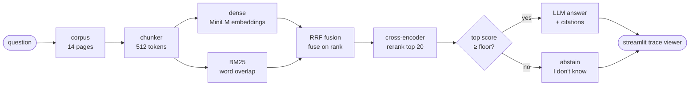

# Eval-driven RAG over football-analytics docs

A retrieval-augmented Q&A system over the `socceraction` documentation, built
around one question: **does a change to the retriever actually improve
answers, or does it just look better on a metric?** Everything here is
measured on a hand-labeled set and reproducible from a script.

**Try it:** `streamlit run app.py` — an interactive trace viewer that shows
every retrieval stage, its scores, and the answer with citations.

## Results at a glance

30 hand-labeled questions, scored as two slices with separate denominators.

| What | Result |
|---|---|
| Retrieval strategy, chunk size held at 512 | `all@5` **0.875 → 0.917**; MRR **0.838 → 0.910** (dense → hybrid → rerank) |
| Best cell in the whole ladder | 512-token chunks, hybrid, reranked — `all@5` 0.917, MRR 0.910 |
| What it still can't do | The relevance floor rejects only **1 of 6** unanswerable questions |
| Label audit findings | **3** of my own labels were wrong; correcting them *raised* the score with no retrieval change |
| Retrieval regressions the eval caught | Fusion **loses** a question that dense alone ranks 2nd |

Two of those rows are the point of the project. A retrieval change that lost
a question, and three bad labels I found by reading the corpus document by
document — a system that only prints a top-line number cannot show you either.

Full ladder, threshold curve, and known-failure notes below; every number is
generated into `results/`.

## Why this shape

Most RAG writeups show one number and no way to check it. This one ships the
eval harness, the traces behind the number, and the cost/latency measurements
for the same pipeline — so the claims are auditable rather than asserted.

## How it works



Every box is a real function: chunker in `src/chunk.py`, the three retrievers
and `rrf()` in `src/retrieve.py`, the floor branch in `retrieve()`, and
generation in `src/answer.py`.

Dense retrieval matches on meaning; BM25 matches on words. They fail
differently — the embedding handles "how do I start?" → "installation", BM25
handles the exact product name the embedding has never seen — so fusing them
beats either alone. The cross-encoder is a second model that reads the
question and each candidate chunk *together* and reorders them. It is the
slowest stage and cannot rescue a document the first stage missed.

## Setup

```bash
python3 -m venv .venv && source .venv/bin/activate
pip install -r requirements.txt
export ANTHROPIC_API_KEY=...      # only needed for generation and the load test
python3 scripts/fetch_corpus.py   # downloads + cleans corpus/ (optional; already committed)
```

Retrieval and the ablation ladder need no API key at all — they run entirely
on local models. Only `app.py`'s Generate button and `bench/loadtest.py` call a
generation API.

### Deploy the trace viewer

[Streamlit Community Cloud](https://share.streamlit.io) hosts `app.py` straight
from this repo. The corpus and the pre-built chunk files are committed, so
there is no build step — the app downloads the embedding and reranker models
on first run, which takes about a minute.

1. Push this repo, then open <https://share.streamlit.io> and **Deploy**.
2. Pick this repository, branch `main`, main file `app.py`.
3. Add one secret, `ANTHROPIC_API_KEY`. Without it the app still runs — only
   the **Generate** button is disabled; retrieval, scores, and traces all work.

Community Cloud issues a permanent `*.streamlit.app` URL. Add that link to
the top of this file once it is live.

## Reproduce

```bash
python3 src/chunk.py 512           # corpus -> data/chunks_512.jsonl
python3 src/chunk.py 512 --selfcheck   # assert no text lost / no mid-word cuts
python3 src/retrieve.py            # assert default fusion is unweighted RRF
python3 src/metrics.py             # ablations + weight sweep + floor curve -> results/
python3 bench/loadtest.py --concurrency 1,4,8 --n 20   # results/latency.json
streamlit run app.py               # trace viewer
```

If you are reviewing this as a candidate: [`docs/INTERVIEW.md`](docs/INTERVIEW.md)
has a 30-second pitch, resume bullets, and the questions an AI Engineer
interviewer is likely to ask, with answers.

## Results

### Retrieval (`results/ablations.md`)

Two slices, two denominators, never folded together:

- **24 answerable** questions — `hit@5`, `all@5`, MRR
- **6 unanswerable** questions — `abstain@5`, the share where the retriever
  returned nothing. 0.000 on every row below because these runs use no
  relevance floor; see the next section.

| chunk | method | hit@5 | all@5 | MRR | abstain@5 |
|---|---|---|---|---|---|
| 256 | dense | 0.917 | 0.750 | 0.807 | 0.000 |
| 256 | hybrid | 1.000 | 0.875 | 0.812 | 0.000 |
| 512 | dense | 1.000 | 0.875 | 0.838 | 0.000 |
| 512 | hybrid | 1.000 | 0.917 | 0.889 | 0.000 |
| 512 | rerank | 1.000 | 0.917 | 0.910 | 0.000 |
| 1024 | dense | 1.000 | 0.875 | 0.808 | 0.000 |
| 1024 | hybrid | 1.000 | 0.917 | 0.840 | 0.000 |

**Two corrections, both of which raised the score. Neither was a retrieval
improvement.**

1. The table previously reported `hit@5` 0.767 and `all@5` 0.733 for the best
   row, computed over all 30 questions. Five of those had no gold documents —
   items a top-5 retriever can never win, because returning `top_k` is what it
   is built to do. Leaving them in the denominator understated the result.
2. Then, auditing all 30 labels against the corpus found **three labels that
   were wrong** — see [`results/label_audit.md`](results/label_audit.md). One
   question ("where should I report a bug?") was labeled with a document that
   cannot answer it; the words appear in *no* document in the corpus, so it
   moved to the unanswerable slice. Two others pointed at the wrong document.
   `hit@5` is now 1.000 (24/24).

The best row is now **hit@5 1.000 (24/24), all@5 0.917 (22/24)**.

**Read this honestly — and this is now the important caveat.** `hit@5` 1.000
means the metric is *saturated*, not that the system is perfect. The
remaining headroom is entirely in `all@5`, and only two questions still miss
(both below). The number to quote is 22 of 24, not 24 of 24, and not 0.917
without the denominator. A saturated metric cannot demonstrate improvement;
that is the single strongest argument for a larger corpus.

What still holds, and what moved:

- `all@5` rises 0.750 → 0.917 across the ladder and is the metric that predicts
  answer quality on multi-hop questions. Hybrid retrieval is what does it —
  it finds the *second* required document, not just the first.
- The cross-encoder reranker lifts MRR (0.889 → 0.910) without changing
  `hit@5` or `all@5`. It reorders, it does not rescue — the expected behavior
  of a second-stage precision tool.
- **A single fusion weight cannot fix both remaining failures, because they are
  opposite.** For id 19 the answer chunk is dense rank 3, BM25 rank 14; for
  id 24 it is dense rank 18, BM25 rank 7. One question needs a retriever that
  trusts dense, the other needs one that trusts BM25. See "Known failures".
- The eval set is the asset, and auditing it was the highest-value hour spent
  on this project. 30 hand-labeled items with doc-level labels, reusable
  across chunk sizes because labels attach to documents, not chunks.

The fix for saturation is a larger corpus, not a better retriever. That is
scoped as the next iteration rather than quietly omitted.

### Known failures (opposite, not the same bug)

At 512/hybrid, only two questions miss, and both lose the same required
document — `spadl-spadl::001` — by opposite routes:

| id | question | needed | dense | BM25 | RRF (equal) |
|---|---|---|---|---|---|
| 19 | raw provider data → unified action representation | data-index, spadl-spadl | **3** | 14 | 7 |
| 24 | convert actions into a pandas dataframe | intro, spadl-spadl | 18 | **7** | 11 |

Both lose the second required document, which is exactly what `all@5` is
measuring. But id 19 wants more dense and id 24 wants more BM25, so no
constant weight recovers both — see the sweep below.

### Fusion weight sweep (`results/dense_weight.md`)

The obvious fix was weighted RRF: trust dense more. `rrf()` now takes a
`weights` tuple, and the whole curve is published rather than one value,
because any single number here was read off these same 24 questions.

| dense_weight | all@5 | MRR | all@5 misses |
|---|---|---|---|
| 0.00 (BM25 alone) | 0.833 | 0.722 | 4, 9, 19, 24 |
| 0.50 (shipped) | 0.917 | 0.889 | 19, 24 |
| 0.55–0.70 | **0.958** | ~0.87 | 24 |
| 0.75 | 0.917 | 0.844 | 21, 24 |
| 1.00 (dense alone) | 0.875 | 0.838 | 21, 24, 25 |

`all@5` 0.917 → 0.958 (23 of 24) over 0.55–0.70, and it costs nothing: no
question that already passed stops passing. Past 0.70 id 21 breaks, because
id 21 is the same shape as id 24 — a lexically-worded question that BM25 was
carrying.

**MRR moves the other way** (0.889 → ~0.87) and the headline is not
gratuitous: the plateau trades a little rank precision for one more multi-hop
document found. The system still ships at 0.5, because 0.6 was chosen by
reading this table and reporting 0.958 would be reporting a number fitted to
the eval set it is measured on. The sweep is the deliverable; the operating
point is not a claim.

**The real fix is a per-query retriever choice**, not a better constant: pick
the weight from the query (a question dense scores highly *and* whose top BM25
ranks are weak is a semantic one). That needs a held-out set to fit against,
which is why it is scoped rather than built.

### Abstention (`results/threshold.md`)

A retriever that always returns 5 chunks cannot answer "I don't know." The
only way out is a relevance floor: if the best score is under it, return
nothing. The floor is a threshold, so reporting one number would mean tuning
it on the same 30 questions the score is reported on. Instead, the whole
trade-off curve is published:

| floor | answerable all@5 kept | unanswerable abstain@5 |
|---|---|---|
| -10.249 | 1.000 | 0.167 | ← selected |
| -7.574 | 1.000 | 0.167 |
| -6.334 | 0.958 | 0.333 |
| -6.248 | 0.958 | 0.667 |
| -5.685 | 0.917 | 0.667 |
| -3.330 | 0.833 | 0.833 |
| -0.271 | 0.625 | 0.833 |
| 0.022 | 0.583 | 1.000 |
| 7.214 | 0.042 | 1.000 |

**This result is unimpressive and the table shows why.** The zero-regression
point rejects **1 of 6** unanswerable questions. Pushing higher buys rejection
only by silencing questions the corpus can answer: at -6.248 the system
declines 4 of 6 unanswerables, but it also silently refuses to answer id 1
("How do I get started with the library for the first time?"). Getting to a
perfect 6/6 costs 42% of answerable recall.

The selection rule in `sweep_threshold()` is therefore *maximize rejection
subject to silencing nothing already correct* — not a retention-percentage
bound. An earlier version used "keep ≥90% of answerable," which is only 2
questions at n=24, and it picked a floor that broke a real query while a
strictly better zero-regression point sat one row away.

Score overlap is the underlying cause. The cross-encoder scores a topically
adjacent chunk highly for a confidently-worded unanswerable question, so the
two score distributions overlap and no floor separates them. The honest
conclusion is that **6 unanswerable items is far too few to fit or validate a
floor on**; the curve is the deliverable, the operating point is not a claim.

### Generation and serving — harness written, not yet measured

`bench/loadtest.py` is complete: it sweeps concurrency, arms the prompt cache
on and off, and reports p50/p95/p99, throughput, and cost per question
including the one-off cache write. Every result row carries
`cache_engaged`, so a run where the provider silently ignored
`cache_control` cannot be mistaken for a caching win.

**No latency table is published, because no valid run completed.** Two
independent blockers, both environmental:

- The dev proxy in this environment exposes exactly one usable model
  (`ling-3.0-flash-sante:free`) and strips `cache_control` from requests, so
  the caching A/B cannot be measured — both arms would be the same run.
- That model's single shared credential enters a ~100 s cooldown after a
  handful of requests, so concurrency > 1 cannot be sustained long enough to
  produce a p99.

Partial serial data from the one arm that did complete, before cooldowns began:

```
c=1  cache=False  p50=3.87s  p99=10.85s  qps=0.19  $0.380/20q
c=1  cache=True   p50=4.45s  p99=19.68s  qps=0.17  $0.264/20q
```

Those two rows are **not** a result. The cache arm was cheaper only because
the provider dropped the cache directives, and the latency difference is
single-sample noise. Quoting them would be exactly the overclaiming this
project exists to avoid.

To produce the real table, run against a direct Anthropic key:

```bash
export ANTHROPIC_API_KEY=sk-ant-...
export ANTHROPIC_BASE_URL=https://api.anthropic.com   # bypass the local proxy
unset ANTHROPIC_DEFAULT_HAIKU_MODEL
export RAG_MODEL=claude-sonnet-5
python3 bench/loadtest.py --concurrency 1,4,8 --n 40
```

## Design notes worth knowing

**Fusion is on rank, not score.** BM25 output is unbounded and cosine
similarity lives in [-1, 1]. Adding them is meaningless, so `rrf()` sums
`1/(k + rank)` instead. This is why `src/retrieve.py:rrf` takes rankings.

**Reranking is a precision tool.** It re-scores the top 20 candidates with a
cross-encoder. It cannot surface a document the first-stage retriever missed,
which is exactly what the `hit@5` vs MRR split above shows.

**Unanswerable questions are scored as a separate slice.** For an item with no
gold documents, retrieving anything confident is counted wrong, over its own
denominator of 5. Folding it into `all@5` made the metric unwinnable on those
items and understated the rest. A relevance floor is the only way to score
non-zero there, and the floor ships as a curve, not a tuned constant.

**The corpus is small and that is stated, not hidden.** 14 pages, ~12.5k
tokens. Two dead sources were dropped mid-build (`pitchcontrol` docs, which no
longer exist, and a football news site that was methodology-free). A fresh
clone that wants a bigger fight should extend `SOURCES` in
`scripts/fetch_corpus.py`; the eval harness does not need changes, because
labels are doc-level.

**Chunking has no tests, so it has a self-check.** `chunk.py --selfcheck`
asserts the two invariants a cut must never break — no text lost or
duplicated, no chunk starting mid-word — and reports the weakness it does
have: most chunks end mid-sentence, because the cut is fixed-size and not
sentence-aware, with zero overlap. That is asserted as a ceiling rather than a
floor, so it can only improve. Both self-checks were verified by sabotaging
the function and confirming the assertion fires; the mid-word check in
particular is offset-based, because the obvious version (`first_word in text`)
passes a partial word, since `"ution" in text` is true.

### Sentence-aware chunking made it worse (`results/chunking.md`)

The obvious next rung: pack whole paragraphs, never cut a sentence, carry an
overlap tail. It does what it says on the chunk-level metric and **loses on
retrieval**.

| chunker | size | hit@5 | all@5 | MRR | all@5 misses |
|---|---|---|---|---|---|
| fixed | 512 | **1.000** | 0.917 | **0.889** | 19, 24 |
| para | 512 | 0.958 | 0.917 | 0.833 | 9, 16 |

Mid-sentence endings drop 78.8% → 60.0% and nothing improves. Tracing id 16
("how many previous actions does the model look at") shows why, and it is not
a bug — the paragraph build contains the answer formula in exactly the same
two chunks. What changes is the embedding's ranking:

```
dense rank of the vaep chunks        fixed: 1, 2, 3, 7      para: 4, 7, 6, 10
```

VAEP and xT are described in near-identical prose — both "look at previous
actions to predict the next". Under a fixed token cut those two topics land in
*different* chunks by accident, which separates their embeddings. Packing
paragraphs removes that accident, and the two models stop being
distinguishable. Coherence cost more here than the mid-sentence cuts gained.

The chunker stays fixed. This is the clearest result in the project: a
plausible, well-motivated improvement that the eval correctly rejected, and
the reason is a property of the corpus, not a tuning mistake.

## Layout

```
corpus/            cleaned text, one file per doc
eval/golden.jsonl  30 hand-labeled items
src/chunk.py       fixed-size token chunker
src/retrieve.py    dense / BM25 / RRF hybrid / cross-encoder rerank
src/metrics.py     hit@k, all@k, MRR + ablation runner
src/answer.py      generation with prompt-prefix caching
app.py             Streamlit trace viewer
bench/loadtest.py  concurrency sweep, latency percentiles, cost
results/           generated tables
```
